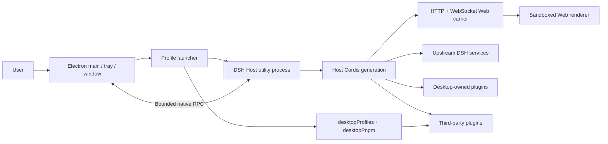

# DSH Desktop Architecture

## Overview

LETSDSH Desktop is a thin Electron host. Electron's main process owns native windows, the tray, and lifecycle, while the official DSH Host starts in a separate Electron utility process by default; the two exchange native capability calls only through bounded RPC. The Host exposes the ordinary Web UI over an HTTP/WebSocket Web carrier. The carrier listens on loopback by default and can be exposed to the LAN only after the user explicitly acknowledges the risk. Desktop does not create a second renderer plugin system and does not expose raw Electron APIs to the page.

## Startup order

Enterprise builds first run a native login window, verify identity online and require initial password changes before selecting identity-specific data directories and browser partitions. Main owns credentials; the Host receives no long-lived credentials. Invalidation locks windows before existing shutdown coordination disposes the Host. See [enterprise development and acceptance](enterprise-development.en.md).

`dsh-enterprise-server`, `dsh-enterprise-admin` and `dsh-enterprise-contracts` own the account API, management UI and shared interfaces in the outer Yarn workspace. They do not modify upstream or automatically start with ordinary Desktop. Native login reuses the UI component; PostgreSQL backs the API and authorization is always checked server-side.

The enterprise knowledge module stores encrypted WeKnora keys, KB bindings and grants on the server. Main forwards fixed retrieval endpoints through the existing loopback capability. Desktop-owned slots control conversation selections; Host injects read-only reference material at the public `agent/pre-step` seam, while the current enterprise model still answers. Authorization is rechecked before results are released. Upstream documents and the Harness submodule remain unchanged. See [enterprise knowledge](enterprise-knowledge.en.md).

`dsh-ppt-runtime` is a desktop-owned Yarn workspace containing the pinned reference PPT runtime, templates and build tooling. PPT state lives under the active account's home directory; Safe Mode excludes the plugin. Versioned patches add the required conversation extension slots to the published client packages without modifying the upstream submodule. See [Desktop refinements](desktop-refinements.en.md) for defaults, native workspace selection and development verification.

The server's enterprise model module owns encrypted provider keys, model registration, employee/department grants and an SSE gateway. Desktop main forwards through a loopback bridge; Host receives only a per-process IPC capability, never login or provider credentials. Enterprise in-memory composition replaces self-configured adapters. Active streams recheck grants and cancel on revocation, disablement or logout. See [enterprise models](enterprise-models.en.md).

The enterprise applications module owns web registration, allowed navigation origins and employee/department grants. A desktop-owned client extension uses sidebar/main-panel slots; main validates dedicated IPC and loads pages in an isolated WebContentsView inside the same window, without forwarding enterprise credentials or loading pages into Host. Browser storage is partitioned by enterprise, employee and application. Active/hidden pages revalidate authorization and close on revocation, service failure or logout; target systems retain their own authentication and data permissions. See [enterprise applications](enterprise-applications.en.md).

1. Electron acquires the single-instance lock and reads Desktop-owned profile/mode state.
2. The launcher prepares the active profile without modifying profiles merely to list them.
3. The launcher prepares the generation's native runtime, `desktopProfiles` bootstrap, and bundled pnpm environment, then creates the DSH Host utility process by default. `DSH_DESKTOP_ISOLATED_HOST=0` remains only as a diagnostic fallback.
4. The Host Cordis root mounts Loader entries in the utility process. Desktop services are registered before third-party entries can consume them; window, tray, and system-dialog work calls back into Electron main through bounded RPC.
5. `dsh-base`, `dsh-web-app`, and the selected profile's third-party bundles compose the Web carrier.
6. The Host binds loopback by default or all network interfaces when the confirmed setting requests it; Electron creates the BrowserWindow and loads the same-origin page through the loopback address.
7. The tray is created only after the Web surface loads, and the profile is committed as last-known-good.

Every profile or mode switch disposes the current generation before starting the next one. Service references, window objects, and subprocess handles must not be cached across generations.

## Host, Client, and native runtime

- **Upstream Host** owns agent, model, tool, session, settings, webServer, and subprocess capabilities.
- **Desktop Host** owns the window, tray, profiles, terminal, updates, and the two public Desktop services.
- **Web Client** contains the official Web UI and third-party browser contributions. It works over the shared Web carrier and does not call Electron directly.
- **Native runtime** lives in Electron main and owns BrowserWindow, the tray, filesystem/network operations, and installers. `desktopRuntime` is for Desktop-owned rows only; the isolated Host reaches it through an explicit RPC bridge.

Compatibility mode validates its environment and adds only an independent 36-pixel Desktop frame through the overlay slot; the official layout, root, sidebar, and conversation remain an unrelated content viewport below it. Extended mode disables the official root layout and installs its own Desktop layout/sidebar registration, which continues to host the official sidebar, conversation, and details occupants inside an inverted-L material frame. Enhanced mode keeps a separate root registration and its original compact internal-caption geometry. macOS and Windows apply capability-gated native materials without changing the ownership of upstream occupant slots.

Desktop-level confirmations, warnings, errors, and results do not enter the Web Client tree. `DesktopDialogWindow` creates a separate sandboxed modal `BrowserWindow`, applies the shared empty utility frame, parents it to the active generation window when possible, and accepts only one bounded local response. Recovery and Profile creation are separate Desktop-owned windows using the same title-free frame. Recovery itself is a shadcn page with reason-first presentation and four workflow tabs; destructive recovery actions delegate their confirmation back to `DesktopDialogWindow`.

### Native shell generation and platform adapters

`ElectronRuntime` coordinates the Host and native desktop environment without directly owning window and tray details. Each start creates one `ElectronShellGeneration` module that completely owns its `BrowserWindow`, `Tray`, related Electron listeners, navigation restrictions, external-link handling, and zoom shortcuts. A generation must be disposed through its idempotent `release()` interface; callers must not cache or destroy those resources separately across generations.

Platform differences live at the `ElectronPlatformStrategy` seam selected once during startup. The Windows, macOS, and Linux adapters declare directory-picking, shell-mode, and update-download capabilities and own their platform-specific menu, Dock icon, and native-material operations. New platform branches belong in the corresponding adapter; the generation and runtime retain only the lifecycle shared across platforms.

## Profile and service boundaries

The profile name and absolute directory come from `desktopProfiles.current`; they must not be inferred from argv, settings, or a URL. `list()` is read-only discovery. `select()` records a pending target and completes the switch through restart.

`desktopPnpm.run()` runs bundled pnpm directly. `runPlugin()` uses packaged DSH CLI semantics so profile initialization, relative sources, and bundle reconciliation remain authoritative. Both operations belong to the current generation and use the subprocess service for complete process-tree ownership.

The launcher-private `desktopRuntime`, `desktopPnpmBootstrap`, Electron executable, Node helpers, and ABI environment are not third-party APIs. The stable package exposes `dsh-plugin-desktop/profile-service` and `dsh-plugin-desktop/pnpm`; the Beta package exposes the corresponding `dsh-plugin-desktop-beta/*` paths.

## Packaging and runtime closure

Release artifacts use Electron Builder, but both Stable and Beta currently disable ASAR explicitly. The root manifest, Desktop runtime, pnpm, node-pty, and Windows ACL/native files remain ordinary files under `resources/app/`. The packaged-runtime gate checks these physical runtime entries; profile fallback links must not target missing paths or paths that Node cannot resolve.

The outer workspace uses Yarn. The pinned `deepseek-harness/` submodule keeps its own pnpm workspace. Stable and Beta Desktop sources live in `dsh-plugin-desktop/` and `dsh-plugin-desktop-beta/`, with a variant-alignment gate protecting shared behavior; neither package edits the upstream submodule.

## Release-channel protocol

Stable and Beta are separate physical npm packages and system applications; Git branches do not define the channels. Stable uses `dsh-plugin-desktop`, `DSH Desktop`, and `ai.deepseek.dsh.desktop`; Beta uses `dsh-plugin-desktop-beta`, `DSH Desktop Beta`, and `ai.deepseek.dsh.desktop.beta`. `upstream.json` records both channels' upstream versions, commits, and vendored-runtime manifests. Exact root resolutions ensure that each workspace resolves only its own DSH runtime.

Version checks and installer downloads send `X-DSH-Desktop-Channel: stable|beta`. A check also sends the current version, while a download sends `X-DSH-Desktop-Target-Version`; the service must echo the requested channel and version. Legacy clients without the channel header are treated as stable. A Beta client requires an explicit `channel: "beta"` response. Stable accepts only release SemVer, while Beta accepts only `-beta.N`. Automatic Beta updates query only Beta. **Install Stable Edition** is a separate explicit operation that may select a lower version and installs Stable alongside Beta.

The service must implement these selection and echo rules, with complete platform artifacts for both channels, before a Beta release becomes discoverable. Otherwise the client treats the response as invalid and will not silently cross channels.

## Maintainer reading

- [Desktop service contract](../dsh-plugin-desktop/docs/plugin-services.md)
- [Package README](../dsh-plugin-desktop/README.md)
- [Pinned upstream and isolated Yarn workspace](../.agents/notes/implemented/process/2026-08-15-pinned-upstream-and-isolated-yarn-workspace.md)
- [Profile and pnpm services decision](../.agents/notes/implemented/architecture/2026-08-15-desktop-profile-and-pnpm-services.md)
- [Advanced shell decision](../.agents/notes/implemented/architecture/2026-08-15-desktop-advanced-shell.md)
- [Native shell generation and platform adapters](../.agents/notes/implemented/architecture/2026-08-19-native-shell-generation-and-platform-adapters.md)
